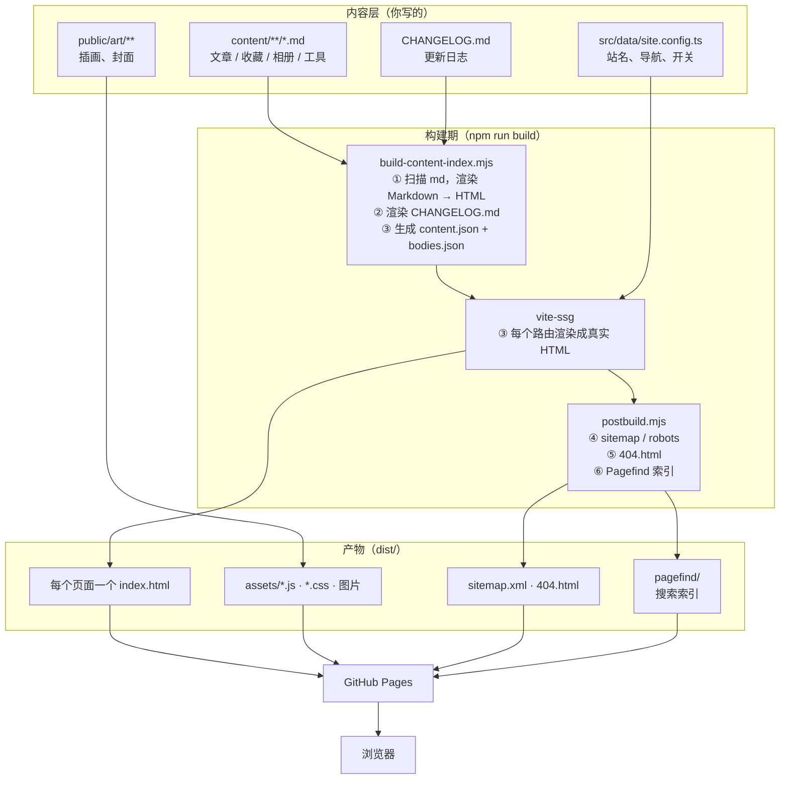
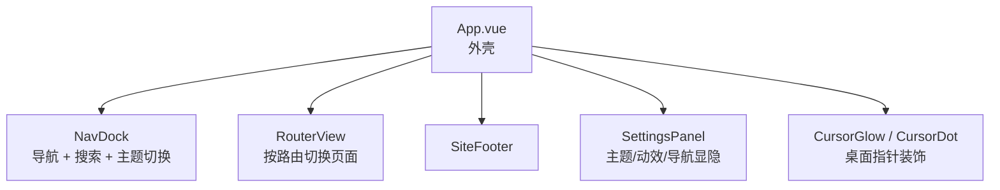
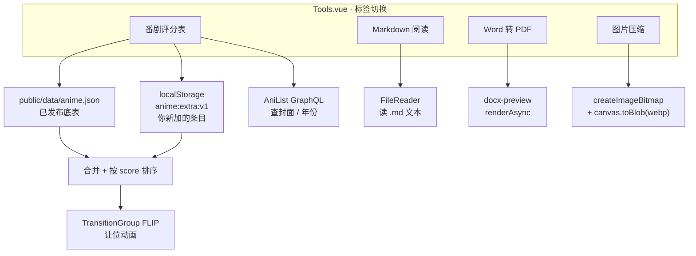
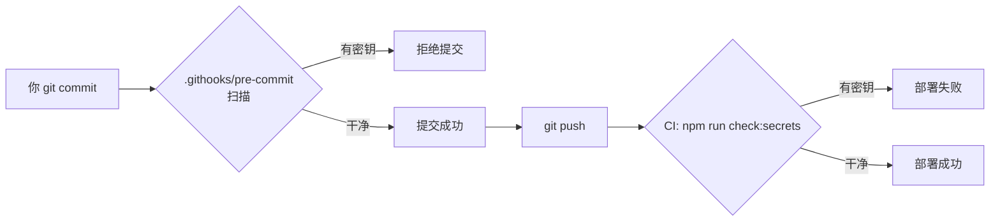

# 架构说明

> 想知道这东西内部怎么运转的看这份。只想改内容的话，看 [EDITING.md](EDITING.md) 就够了。

---

## 一句话概括

**Markdown 文件 → 构建脚本变成 JSON → Vue 在构建时把每个页面渲染成 HTML → 上传到 GitHub Pages。**

浏览器拿到的是一堆纯静态文件。没有服务器在跑，没有数据库，没有 API。

---

## 整体流程



---

## 三个阶段

### 阶段一：内容索引（`scripts/build-content-index.mjs`）

扫描 `content/` 下所有 `.md`，做三件事：

1. **解析 frontmatter**（两个 `---` 之间的 YAML），校验必填字段
2. **把正文 Markdown 渲染成 HTML**，代码块用 Shiki 高亮
3. **输出两份文件**：
   - `src/generated/content.json` —— 所有文章的**元数据**（标题、日期、摘要、标签……），不含正文
   - `src/generated/bodies.json` —— 文章**正文**的 HTML，按路径索引

**为什么拆成两份**：首页、列表页只需要元数据。如果正文跟元数据打包在一起，
首屏 JS 会带上全部文章内容，几十篇文章就是几 MB。拆开之后，正文只有打开文章详情页才下载。

这一步在 `npm run dev` 和 `npm run build` 开始时都会自动跑。

**更新日志不走 `content/` 目录**，而是直接读仓库根目录的 `CHANGELOG.md`。
`loadChangelog()` 用同一套 Markdown + Shiki 管线把它渲染成 HTML，
塞进 `content.json` 的 `changelog` 字段（`{ html, updated }`）。
`/changelog` 页在 `setup` 里同步取用，所以预渲染出来的 HTML 已经带完整正文，
不需要像文章页那样在 `onServerPrefetch` 里单独取。

### 阶段二：预渲染（`vite-ssg`）

普通 Vue SPA 的问题是：服务器返回一个空的 `<div id="app">`，内容全靠 JS 在浏览器里生成。
后果是搜索引擎抓不到内容，而且直接打开深层链接会 404（GitHub Pages 没有回退到 index.html 的机制）。

vite-ssg 的做法是：**在构建时启动一个 Node 环境，把每个路由都真实渲染一遍**，
把渲染结果写进 HTML 文件。

```
dist/index.html                     ← 首页的真实内容
dist/posts/index.html               ← 文章列表的真实内容
dist/posts/2026/frieren/index.html  ← 某篇文章的真实内容（含正文）
dist/about/index.html
...
```

**两个关键点**：

1. **动态路由要显式告诉它**。文章页是 `/posts/:year/:slug`，vite-ssg 不知道有多少篇文章。
   所以 `vite.config.ts` 里读 `content.json`，把所有真实路径塞进 `includedRoutes`。
   同时要把带 `:` 的模板路由**过滤掉**，否则它会试图创建名叫 `:year` 的目录，直接报错。

2. **异步数据要提前取**。`PostDetail.vue` 的正文是异步加载的，如果只在 `onMounted` 里取，
   预渲染出来的就是一个空壳。所以用了 `onServerPrefetch`，让构建阶段就把正文取好。

### 阶段三：后处理（`scripts/postbuild.mjs`）

vite-ssg 输出完之后，再补几样它不管的东西：

| 产物          | 作用                                                     |
| ------------- | -------------------------------------------------------- |
| `sitemap.xml` | 给搜索引擎的页面清单（不含 credits / secret / 404）      |
| `robots.txt`  | 抓取规则，指向 sitemap                                   |
| `404.html`    | GitHub Pages 用它接住错误路径                            |
| `pagefind/`   | 搜索索引                                                 |
| `.nojekyll`   | 让 Pages 别做 Jekyll 处理（否则 `_` 开头的目录会被吞掉） |

**404 页有个坑**：vite-ssg 把它渲染成 `dist/404/index.html`，但 GitHub Pages 只认根目录的 `404.html`。
而且如果先写 `404.html` 再建搜索索引，Pagefind 会把 404 页也收进去——
搜出来的结果里出现一个"这一页不见了"，很怪。

所以顺序是：**读进内存 → 删掉 → 建索引 → 写回根目录**。

---

## 运行时结构

浏览器里跑的是一个很小的 Vue 应用：



数据来源只有一个：`content.json`（已打包进 JS）。
文章正文通过动态 `import()` 单独加载；更新日志正文则同步放在 `content.json`
的 `changelog.html` 里（因为它只有一份，不值得单独拆一个 JSON）。

`/changelog` 不在主导航里，入口收在设置抽屉「关于」组的折叠块中，
默认合上，不占抽屉的地方。`postbuild.mjs` 会把它加进 sitemap。

**状态存在哪**：

| 状态                 | 存在哪         | 说明                               |
| -------------------- | -------------- | ---------------------------------- |
| 主题、动效、导航显隐 | `localStorage` | 访客自己调，下次来还在             |
| 已读记录（既読）     | `localStorage` | 只在本地，从不上传                 |
| 当前页面             | URL            | 所有页面都有真实地址，可以直接分享 |

---

## 设计系统

**颜色只在 `src/styles/tokens.css` 里定义**，组件一律用 `var(--xxx)` 引用。
好处是两套主题（Daylight / Neon）只需各定义一遍，切换到 `html[data-theme]` 上改一个属性，
整站配色就变了，组件代码完全不用知道自己在哪套主题里。

**动效有双重开关**：

1. `prefers-reduced-motion` —— 系统级无障碍设置，用户设了就自动降级
2. `[data-motion='off']` —— 站内设置面板的开关

两者都会把所有动画时长归零。

**字体是子集化的**。中文字体完整版动辄 5-10 MB，直接用会让页面卡住好几秒。
`scripts/subset-font.py` 扫描 `content/` 和 `src/` 里实际出现的每一个字，
只保留用到的字形，体积降到 100-300 KB。代价是新增生僻字后要重跑 `npm run fonts`。

## 全站配色过渡（@property）

主题切换、滑进摸鱼分区时整页的底色/墨色/描边是**渐变**过去的，不是瞬间替换：

1. `tokens.css` 用 `@property` 把 `--bg` `--ink` `--line` 等十几个变量
   登记成 `<color>` 类型——普通 CSS 变量只是一串字符，登记后浏览器才能插值
2. `base.css` 在 `html` 上挂一条 `transition: --bg 520ms, ...`
3. 变量在 `<html>` 上被换掉（`data-theme` 或 `data-zone` 切换）时，
   因为变量是**继承**的，整棵树每帧拿到的都是中间值 → 全站一起淡过去

摸鱼分区的暗场是**独立于主题的第三层**（`html[data-zone='moyu']`），
写在两套主题之后靠"后者胜"覆盖——"看到哪儿"决定暗场，"访客选了什么"决定主题，互不干扰。

不支持 `@property` 的浏览器整段忽略，退回瞬间切换——不会坏，只是没有过渡。

## 摸鱼分区与在线小说

首页滑到底的附录区（`MoyuZone.vue`）懒挂载五块内容，用 `IntersectionObserver` +
轮询兜底（嵌入式 WebView 里 IO 不可靠，见组件注释）。

**小说管线**（`scripts/novel.mjs` → `build-novel.mjs` + `optimize-novel-images.py`）：

```
EPUB ──解包──> OPF/NCX ──白名单清洗──> public/novels/<slug>/ch-N.html
                                        └─ index.json + books.json（书架）
TXT  ──按「第X章/番外」分节──> 同上（GBK 自动转 UTF-8）
原图 ──raw/novels/<slug>/img/──> Pillow 转 WebP（质量自适应）
```

阅读器（`NovelReader.vue`）运行时 fetch 章节，CSS 多列分页（一列 = 一页），
进度按 slug 存 `localStorage`。书架来自 `books.json`，≥2 本书时显示切换器。

**便条板**（`NoteBoard.vue` + `useNotes.ts`）：纯静态站没有后端，跨设备走
ntfy.sh 公共中转（连不通可在锁屏换一台兼容实例，地址只存本机 localStorage）。
主题名 = SHA-256(密钥) 的前 40 位——密钥不出现在任何 URL，算不出主题名就读不到消息。
板上不限条数，单次拉取截到 `FETCH_LIMIT`（50）条，免得老主题一次拉回几百条。

**猜番的一轮制**（`AnimeQuiz.vue`）：一轮 `roundSize` 题（10/20/30/50，默认 20），
答对百分比跨过 5/10/20/40/60/80/100 时盖章夸一句。里程碑按百分比而非题数算，
所以不同题量的一轮有同样的七道坎。`bestSeen` 记录已庆祝到哪一档，
防止横幅退场后同一档被重复触发。

## 顶栏玩具

`NavDock.vue` 点靠左的栏目飞到屏幕左侧、靠右的飞到右侧，变成竖排侧栏
（仅 ≥1366px）。动画是 **FLIP**：记旧位置 → 换类让布局瞬间到位 → 记新位置 →
WAAPI 从旧位置飞过去，中途带压缩和 6° 空翻。停靠位存模块级 ref，
SPA 会话内跨路由保留，刷新回中。窄屏 / 动效关闭 / 摸鱼分区（底部停靠）时让位。

---

## 三个"同人志"设定

站点的视觉隐喻是**一本自己印的同人志**。三处功能都建立在这个设定上，
共用 `src/composables/useBook.ts` 里的一套计算：

| 功能         | 在哪                              | 怎么算                           |
| ------------ | --------------------------------- | -------------------------------- |
| **页码**     | 文章页页眉 `第 08 話 · P.14 / 14` | 前置页 6 页 + 文章序号           |
| **目次视图** | 文章列表页右上角切换              | 第 X 話 + 标题 + 引导点线 + 页码 |
| **既読章**   | 卡片左下 / 目次行末 / 文章末尾    | 滚到「本页完」才盖章             |

**"第 X 話"** 是倒序号：最新的一篇是第 N 話，最早的是第 1 話。
**"第 X 話"** 不会因为新增文章而变，所以旧文章的编号是稳定的。

**既読的判断**：不是打开页面就记，而是要滚到文末那个 `[data-post-end]` 元素进入视口。
用 IntersectionObserver 监听，读完了才 `markRead()`。记录存在 `localStorage`，
最多保留 300 条，只在本地，从不上传。

---

## 搜索是怎么工作的

**索引在构建时建**（`pagefind` 命令），产物是 `dist/pagefind/` 下一堆静态文件。
浏览器里只加载一个很小的 WASM 模块和按需的索引分片。

**中文需要显式指定语言**：`addDirectory({ forceLanguage: 'zh-cn' })`。
不指定的话 Pagefind 按英文规则切词（按空格），中文一句话会被当成一个巨大的"单词"，
搜「番剧」永远搜不到。

**索引范围**由 HTML 里的标记控制：

- `data-pagefind-body` 加在 `<main>` 上 —— 只有正文进索引，导航和页脚不进
- `data-pagefind-ignore` 加在侧边目录和上下篇导航上 —— 那些是正文的重复或别页内容

**搜索面板**（`SearchPanel.vue`）是懒加载的：Pagefind 模块只在第一次按 `/` 或 `Ctrl+K` 时才下载。
没搜过的人不会为它付流量。

---

## 本地工具（`/tools` 页）

工具箱页面顶部有四个**纯浏览器端**工具。它们不经过构建流程，也不上传任何文件——
只在你的浏览器里读写。



**番剧评分表的排序模型**：总分 = 七项加权和 × 1000，权重写在 `AnimeTable.vue` 顶部的
`W` 常量里。新增条目时立刻算分、插入数组、`TransitionGroup` 用 FLIP 让其余行动画让位。
封面查询走 `anime-aliases.json`（中译名 → 罗马音）再打 AniList，因为 AniList
不认简体中文标题。

**为什么用 localStorage 而不是直接改 JSON**：浏览器里不能写仓库文件。
localStorage 让「加一部」立刻可用，想公开时再点「导出 anime.json」覆盖提交。

---

## 密钥防护



三层：`.gitignore` 挡文件、钩子挡提交、CI 挡部署。
扫描器本身零依赖（纯 Node），扫 20+ 种真实密钥格式和危险文件名。

详见 [EDITING.md 第 13 节](EDITING.md#13-上传前的安全检查)。

---

## SEO

| 项                           | 做法                                   |
| ---------------------------- | -------------------------------------- |
| 每页独立 title / description | `useSeo()` 组合式函数，在 `setup` 里设 |
| 真实 HTML 内容               | vite-ssg 预渲染                        |
| 结构化数据                   | JSON-LD（WebSite + BlogPosting）       |
| 分享卡片                     | 每类页面一张 OG 图（1200×630）         |
| 站点地图                     | 构建时生成 `sitemap.xml`               |
| 规范链接                     | 每页 `<link rel="canonical">`          |

**预览环境不索引**：`robots.txt` 里 Disallow 了 `/credits` 和 `/secret`。

---

## 为什么不用某些东西

| 没用的东西                | 原因                                      |
| ------------------------- | ----------------------------------------- |
| Tailwind                  | 你以后要手改样式，一堆 class 名反而更难找 |
| 评论系统                  | 用户明确说不要                            |
| 统计                      | 用户明确说不要                            |
| Live2D / 3D               | 任务书红线                                |
| 音乐播放器 / 自动播放音频 | 任务书红线                                |
| Google Fonts              | 国内访问经常超时，字体自托管              |
| 运行时 CSS-in-JS          | 静态站点不需要，多一层开销                |
| 图片 CDN                  | GitHub Pages 自带，没必要                 |
| xlsx 解析库               | 评分表改手工逐条维护，不需要整表导入      |

---

## 性能预算

| 项              | 预算        | 现在                          |
| --------------- | ----------- | ----------------------------- |
| 首屏 JS（gzip） | 130 KB      | 见 `npm run build` 输出       |
| 首屏 CSS        | 40 KB       | 单文件，`cssCodeSplit: false` |
| 主视觉图        | 420 KB      | WebP，2400×1400               |
| 文章封面        | 160 KB / 张 | WebP，1200×675                |
| 相册            | 220 KB / 张 | WebP，长边 1600               |
| 字体合计        | 400 KB      | 三套子集                      |

超预算时 `npm run build` 会警告。图片超了 `scripts/optimize-images.py` 会自动降质量重压。
